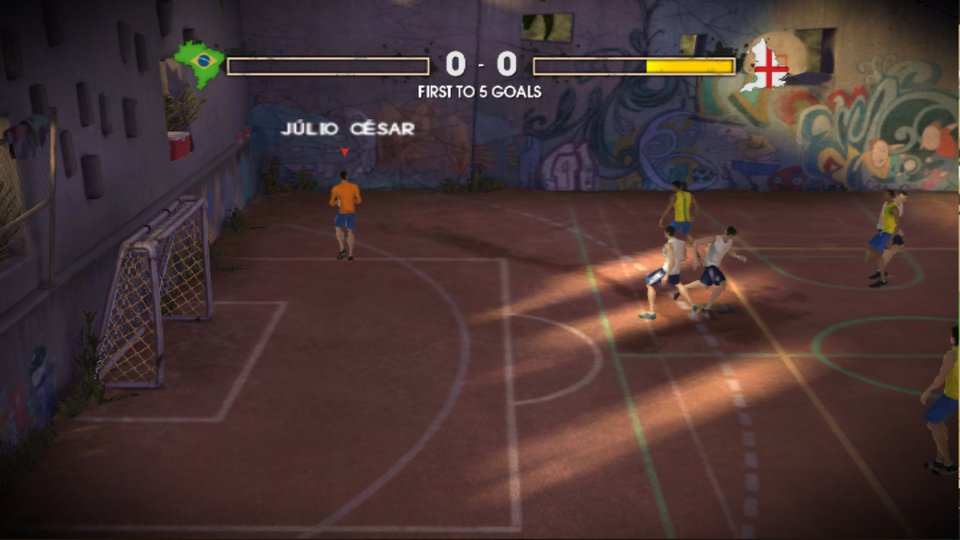
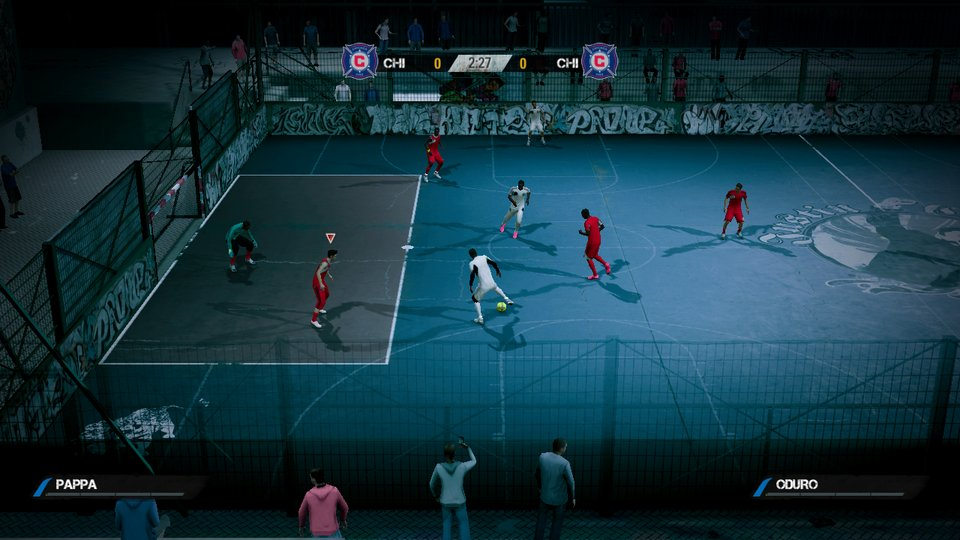
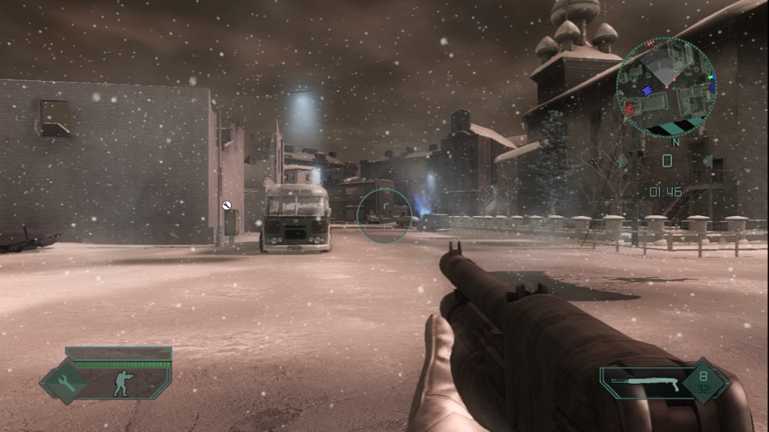
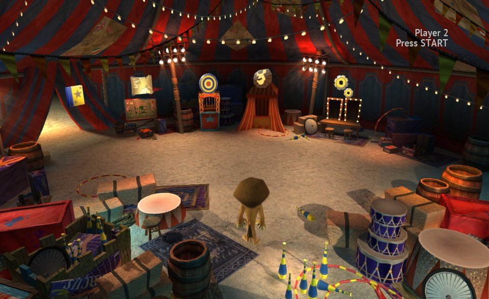
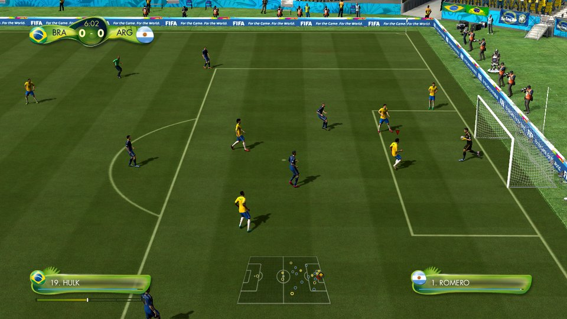
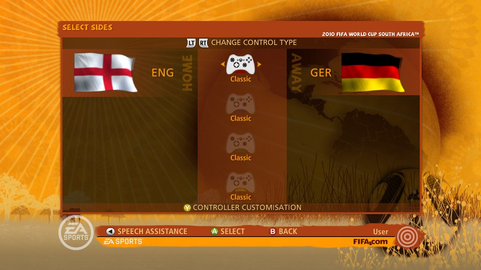
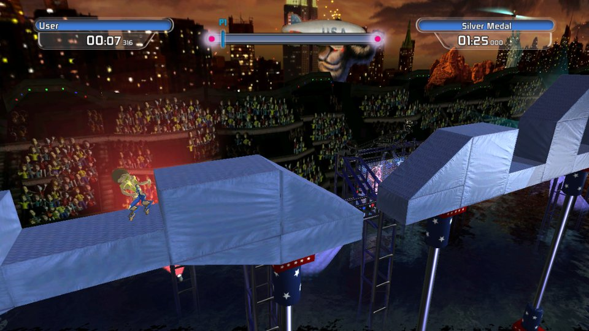

# rexglue-ports

Native PC ports of Xbox 360 games, built from **your own disc** on top of the
[ReXGlue](https://github.com/rexglue) static recompiler (PowerPC to C++). No game content is stored here: no disc
image, executable, game data or generated code.

What the ports add on top of the recompiled code is native: a Direct3D 11 renderer (also on Vulkan through DXVK,
DXVK native on Linux, DXMT on macOS), XMA audio decoded on the host, the in-game PC settings menu (F1) and
modern keyboard, mouse and controller input. The SDK's GPU emulation is not used.

## How to play a game

Windows 10/11 x64. About 15 GB free and 15-60 minutes for the first build of a game.

1. Get this repository, either way:
   - `git clone --recurse-submodules https://github.com/batatinhafcbatatinha-pixel/rexglue-ports.git`, or
   - **Code > Download ZIP** and unpack it, or
   - only [`Launcher.exe`](https://github.com/batatinhafcbatatinha-pixel/port-installer/releases/latest/download/Launcher.exe):
     run it, pick rexglue-ports and a folder, and it downloads this repository there.
2. Run **`Launcher.cmd`** (it downloads `Launcher.exe` from the
   [port-installer releases](https://github.com/batatinhafcbatatinha-pixel/port-installer/releases) the first time).
3. Click **CHOOSE ISO...** and pick your disc image (Redump `.iso` or XISO). The game is recognised from its `default.xex`.
4. Confirm **Install**. The launcher installs what is missing (Python, Visual Studio C++ Build Tools, LLVM/Clang, CMake,
   Ninja), copies and checks the game files, translates the game code and compiles it. Finished steps are skipped next
   time. Log: **Install** tab and `games/<game>/setup-log.txt`.
5. **PLAY**. **PC settings** in the launcher, or the in-game F1 menu: display mode, monitor, refresh rate, V-Sync,
   frame limit, internal resolution, MSAA, effects, controls, language, volume.

Each game folder also keeps its own `Setup.cmd`, which does the same for that one game.

## Layout

| Folder | What it holds |
| --- | --- |
| [`games/`](games/) | one folder per game: its manifest, hooks, game-specific native code, build and play scripts |
| [`shared/src/`](shared/src/) | the native layers the games share (see below) |
| `tools/port-installer` | the game-file installer / launcher (submodule: `git submodule update --init`) |
| `launcher.json`, `Launcher.cmd` | the launcher's list of games and its download script |

Shared layers (`shared/src`):

- `platform/` - window, shader compiler, Win32 subset for Linux/macOS, fonts
- `pc_settings.*`, `pc_font.*`, `script_input.h` - the PC settings menu (each game keeps its own `pc_theme.cpp` look)
- `native_audio/` - XMA decoding and audio output (FIFA Street 3, BF2: Modern Combat, Madagascar 3, Doritos)
- `native_gpu/` - the Xenos renderer of Madagascar 3, BF2: Modern Combat and Doritos
- `native/` - the renderer and audio of the FIFA Street 2012 engine family (FIFA Street, 2014 FIFA World Cup, 2010 FIFA World Cup)

Each game's `project/src/port_game.h` sets `PORT_GAME` (ids in `shared/src/port_games.h`) and the guest addresses
the shared code needs; behaviour that differs between games is selected with `#if PORT_GAME == PORT_GAME_<NAME>`.
The shared files were merged from the games' former copies and checked so that every game compiles the same code
as before.

## Games

| Game | Disc | State |
| --- | --- | --- |
| [FIFA Street 3](games/street3/) | Xbox 360 | playable |
| [FIFA Street (2012)](games/street4/) | Xbox 360 | playable |
| [Battlefield 2: Modern Combat](games/bf2mc/) | Xbox 360 | playable |
| [Madagascar 3](games/madagascar3/) | Xbox 360 | reaches gameplay |
| [2014 FIFA World Cup Brazil](games/copa2014/) | Xbox 360 | in progress |
| [Doritos Crash Course](games/doritos/) | Xbox 360 (XBLA) | early work, not in the launcher yet |
| [2010 FIFA World Cup South Africa](games/wc2010/) | Xbox 360 | early work, not in the launcher yet |

Only these exact discs are supported (checked by SHA-256, see each `games/<game>/installer.json`). Each game folder
has its own README with how to build and play it.

## Screenshots

Each port at the furthest point it reaches today.

<table>
  <tr>
    <td align="center" width="50%">
       
      <b>FIFA Street 3</b> 
      Xbox 360 &middot; a match, Brazil against England
    </td>
    <td align="center" width="50%">
       
      <b>FIFA Street (2012)</b> 
      Xbox 360 &middot; a match in progress
    </td>
  </tr>
  <tr>
    <td align="center" width="50%">
       
      <b>Battlefield 2: Modern Combat</b> 
      Xbox 360 &middot; the first campaign mission
    </td>
    <td align="center" width="50%">
       
      <b>Madagascar 3</b> 
      Xbox 360 &middot; the circus hub, playing as Alex
    </td>
  </tr>
  <tr>
    <td align="center" width="50%">
       
      <b>2014 FIFA World Cup Brazil</b> 
      Xbox 360 &middot; a match, Brazil against Argentina
    </td>
    <td align="center" width="50%">
       
      <b>2010 FIFA World Cup South Africa</b> 
      Xbox 360 &middot; choosing sides before a match
    </td>
  </tr>
  <tr>
    <td align="center" width="50%">
       
      <b>Doritos Crash Course</b> 
      Xbox 360 &middot; title screen (native renderer in progress)
    </td>
  </tr>
</table>

## License

The ports' own code and tooling: MIT ([LICENSE](LICENSE)); third-party notices in each game's `NOTICE.md` and
`licenses/`. The games, their code, trademarks and assets belong to their publishers and rights holders; these
ports are not affiliated with or endorsed by them or by Microsoft.
